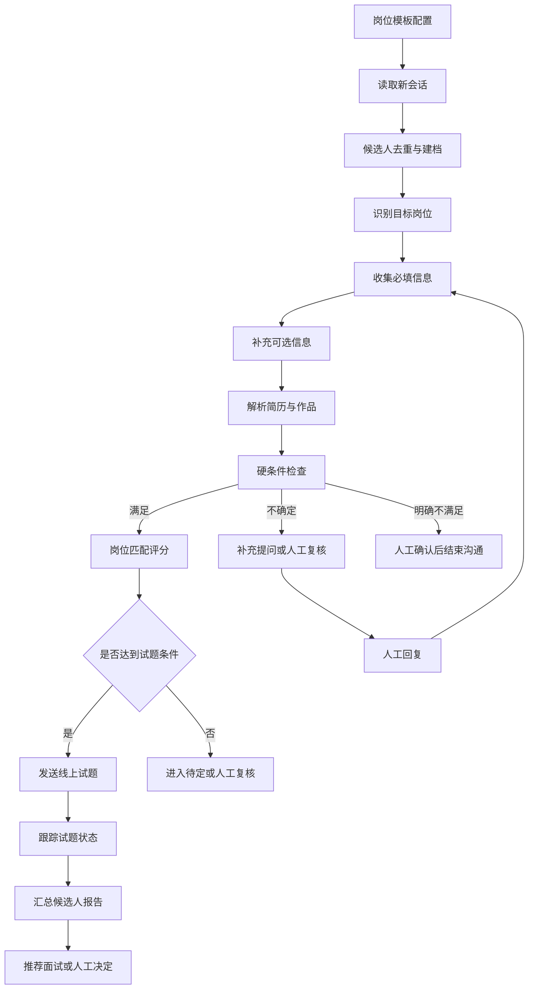

# BOSS 直聘招聘自动化助手：整体设计文档

**版本**：0.2<br>
**状态**：接入原型已完成，公司招聘端 UI 与会话列表读取已验证；候选人详情、岗位识别、消息去重和发送链路处于设计与适配阶段<br>
**适用场景**：游戏行业多岗位招聘；岗位包括策划、美术、UI、客户端、Unity、测试等；单账号每天约 100+ 条消息；使用 BOSS 直聘网页版。

## 0. 当前项目状态

### 0.1 已完成并有证据支持的功能

| 模块 | 当前结果 | 证据或入口 |
|---|---|---|
| 运行环境检查 | 已完成 Node、Chrome、端口和配置校验 | `npm run doctor` |
| 专用浏览器启动 | 已完成个人/公司双 profile、独立 Chrome 用户目录、独立 CDP 端口 | `npm run login`、`npm run company:login` |
| 本机 CDP 连接 | 已完成回环地址限制、目标页面校验、连接超时和断线处理 | `src/cdp.mjs`、`tests/cdp.test.mjs` |
| BOSS 页面状态识别 | 已完成页面来源、登录/验证提示、个人端与招聘端 UI 信号区分 | `src/page-status.mjs`、`tests/page-status.test.mjs` |
| 公司招聘端 UI | 已确认 `/web/chat/index`、账号控件、招聘导航和本次加载的 40 条会话行 | `docs/company-login-and-session.md` |
| 标签页选择 | 已完成只列出 BOSS 页面、多个页面时要求显式 `--target` | `node src/cli.mjs tabs --profile company`、`status --target` |
| 数据安全边界 | 不导出 Cookie/Token；状态输出去除正文与查询参数；`.runtime/` 不进入版本库 | `.gitignore`、连接验收记录 |
| 个人端控制演示 | 已完成一次会话打开、消息方向判断、输入框填充与清空；未点击发送 | `docs/boss-control-demo.md` |
| 自动化测试 | 当前离线测试覆盖 profile 隔离、来源限制、目标歧义、CDP 超时/断线和导航竞态 | `npm test` |

### 0.2 尚未实现或尚未验收的功能

- `list_conversations`、`read_conversation` 和 MCP server 尚未实现。
- 公司账号的单候选人详情、历史消息分页、稳定消息 ID、附件/简历映射尚未验证。
- 真实消息发送、发送回执、未知结果处理、试题发送和提醒尚未实现。
- 岗位识别、候选人结构化档案、评分和报告目前只有规则设计，没有业务数据回放结果。
- 去重设计已在本版确定，但尚未接入真实 BOSS 消息流；在没有稳定平台 ID 时不能宣称精确去重已通过。

本版文档中的“已完成”只指上表的代码或实测证据；其余内容是下一阶段实现规范，不应当在技能描述中写成现有能力。

## 1. 项目目标

### 1.1 目标

建立一个由岗位规则驱动的招聘自动化助手，完成以下工作：

1. 读取 BOSS 直聘新消息并识别候选人、岗位和会话状态。
2. 按岗位配置自动收集必填信息，并尽可能收集可选信息。
3. 解析简历、作品集和聊天内容，形成结构化候选人档案。
4. 根据岗位硬条件和软条件进行解释性筛选。
5. 对合适候选人发送线上试题，跟踪查看、完成、逾期和结果。
6. 自动生成候选人汇总，供招聘人员决定是否面试。
7. 遇到未知、敏感、争议或低置信度问题时暂停自动流程并通知人工。
8. 记录每次消息、判断、发送、人工修改和状态变化，保证可追溯。

### 1.2 不在第一阶段实现的内容

- 绕过验证码、登录保护或平台风控。
- 批量抓取与当前招聘无关的候选人。
- 隐瞒机器人身份、伪造人工身份或伪造招聘信息。
- 自动做最终录用、薪资承诺或合同承诺。
- 以年龄、性别、婚育、户籍、民族、健康等敏感因素进行自动淘汰。

## 2. 总体判断

系统技术上可行，推荐采用“自动处理为主，异常人工接管”的模式。

由于目前没有确认到可直接使用的公开招聘聊天 API，第一版以已登录的 BOSS 网页作为执行入口。网页适配器需要支持页面变化检测、登录状态检测、验证码暂停、发送前候选人校验和幂等去重。

系统的核心价值不在于模拟人工点击，而在于把每个岗位的招聘方法固化成可配置规则，并将聊天、简历、试题和筛选结果统一到一个候选人档案中。

## 3. 系统角色

### 3.1 招聘负责人

- 配置岗位和筛选标准。
- 审核自动生成的岗位模板。
- 处理异常问题和特殊候选人。
- 查看候选人汇总和面试建议。

### 3.2 系统管理员

- 维护 BOSS 网页连接。
- 管理消息队列、运行日志和错误告警。
- 管理权限、数据保留和系统配置。

### 3.3 候选人

- 接收岗位介绍和问题。
- 提供必要的经历、技能、薪资和到岗信息。
- 在符合初筛条件后完成线上试题。

## 4. 端到端业务流程



## 5. 候选人状态机

```text
NEW
  -> CONTACTED
  -> WAITING_REPLY
  -> INFO_PARTIAL
  -> READY_FOR_REVIEW
  -> TEST_PENDING
  -> TEST_SENT
  -> TEST_COMPLETED
  -> INTERVIEW_RECOMMENDED
  -> INTERVIEW_INVITED
  -> INTERVIEWED
  -> HIRED / REJECTED

任意状态可以转入：
HUMAN_HANDOFF、ERROR_PAUSED、DO_NOT_CONTACT
```

状态变化必须写入事件日志，包含操作者、时间、触发原因、原状态和新状态。

## 6. 系统架构

```text
┌──────────────────────────────────────┐
│ BOSS 网页适配器                       │
│ 读取会话 / 识别页面 / 发送消息 / 登录检测 │
└──────────────────┬───────────────────┘
                   │
┌──────────────────▼───────────────────┐
│ 消息队列与任务调度                     │
│ 去重 / 幂等 / 重试 / 发送顺序 / 暂停     │
└──────────────────┬───────────────────┘
                   │
┌──────────────────▼───────────────────┐
│ 招聘规则引擎                           │
│ 岗位分类 / 问题编排 / 筛选 / 试题触发     │
└──────────────┬───────────────┬────────┘
               │               │
┌──────────────▼──────┐ ┌──────▼──────────────┐
│ 候选人档案与知识库    │ │ 人工接管中心          │
│ 简历 / 对话 / 作品 / 试题 │ │ 通知 / 草稿 / 恢复流程 │
└──────────────┬──────┘ └──────┬──────────────┘
               │               │
          ┌────▼───────────────▼────┐
          │ 汇总报告、日志与统计      │
          └─────────────────────────┘
```

### 6.1 BOSS 网页适配器

2026-11-02 接入进展：采用“专用 Chrome 用户目录 + 本机 CDP 连接 + BOSS 专属工具”架构。个人端页面读取和控制演示已通过；公司端 `/web/chat/index` 已确认招聘 UI 和本次加载的 40 条会话列表行。当前只证明招聘端 UI/列表可读，不证明单会话详情、稳定消息 ID、发送或回执可用。MJ 的接口和登录检测不能直接用于 BOSS；必须依据 BOSS 实际页面重新做字段映射。详见 [BOSS 网页接入方案](boss-web-access.md)、[公司登录与会话存储](company-login-and-session.md) 和 [连接验收记录](boss-connection-validation.md)。

第一版需要实现：

- 读取会话列表和未读消息。
- 获取候选人基本信息和简历入口。
- 识别当前岗位上下文。
- 发送文字消息和经过审核的试题链接。
- 检测登录过期、验证码、页面结构变化和发送失败。
- 发送前校验候选人姓名、会话 ID 和消息内容。

禁止通过技术手段绕过平台验证。任何页面异常都应暂停写入动作并转入人工处理。

### 6.2 消息队列

入站消息和出站动作分别使用幂等键。入站记录优先使用平台稳定消息 ID；出站动作使用业务意图 ID，不能把“相同正文”直接当作同一条消息。

```text
inbound:  account_id + conversation_id + platform_message_id
outbound: account_id + conversation_id + intent_id + message_version
```

没有稳定平台消息 ID 时，使用“发送方 + 消息类型 + 规范化正文哈希 + 页面时间 + DOM 顺序”的弱指纹，并标记 `identity_confidence=weak`；弱指纹只能阻止同一读取窗口内的重复入库，不能作为精确历史去重依据。详见第 20 节。

队列支持：

- 未读消息任务；
- 回复任务；
- 试题发送任务；
- 试题提醒任务；
- 人工接管任务；
- 汇总生成任务。

### 6.3 招聘规则引擎

规则引擎负责选择岗位模板、决定下一问题、判断信息是否完整、执行硬条件和计算推荐分数。规则引擎输出建议，不直接改变录用结果。

### 6.4 人工接管中心

每个异常任务应包含：

- 候选人和岗位；
- 当前流程阶段；
- 最近若干轮对话；
- 已收集信息；
- 候选人待回答的问题；
- 系统识别到的风险；
- 建议回复草稿；
- 继续自动流程的按钮。

## 7. 岗位模板设计

每个岗位配置独立模板，但共享公共字段和公共对话规则。

```yaml
job_id: unity-client
job_name: Unity客户端开发
version: 1

intro:
  company: 公司名称
  location: 工作地点
  salary_range: 薪资范围
  work_mode: 全职

required_questions:
  - id: years_unity
    label: Unity经验年限
    question: Unity 使用了几年？
    answer_type: number
    required: true
    evidence_required: true

  - id: shipped_projects
    label: 上线项目
    question: 是否有上线项目？主要负责哪些模块？
    answer_type: text
    required: true
    evidence_required: true

optional_questions:
  - id: performance_optimization
    label: 性能优化
    question: 是否做过移动端或大型项目性能优化？
    answer_type: text
    required: false
    priority: high

knockout_rules:
  - id: location_mismatch
    condition: 不接受工作地点
    action: human_review

scoring:
  skill_match: 35
  project_experience: 25
  evidence_quality: 20
  salary_location_match: 10
  availability: 10

online_test:
  enabled: true
  trigger: 初筛评分达到 75 且必填信息完整
  url: https://example.com/test
  time_limit_hours: 48
  reminder_after_hours: 24
  max_reminders: 1

human_escalation:
  - 薪资谈判
  - 福利与合同
  - 候选人投诉
  - 系统无法回答的问题
  - 评分置信度低于 0.75
```

岗位模板需要支持版本号。修改问题或筛选条件后，新候选人使用新版本，历史候选人保留原版本，避免数据解释不一致。

## 8. 对话设计方法

### 8.1 对话原则

- 首次说明招聘助手身份。
- 一次只问一个主要问题。
- 优先收集必填信息。
- 对可选信息按价值排序，不强行问完所有问题。
- 已经从简历识别的信息不重复询问，除非需要确认。
- 候选人拒绝回答可选问题时继续流程。
- 不使用夸大承诺、诱导性表达或虚假紧迫感。

### 8.2 公共流程

```text
身份说明
→ 岗位确认
→ 地点、薪资、经验、到岗时间
→ 岗位专属问题
→ 作品或项目证据
→ 信息复述确认
→ 初筛结果
```

### 8.3 信息完整度

候选人不能只依靠一个总分判断。系统需要同时计算：

- 必填字段完成率；
- 关键字段置信度；
- 证据完整度；
- 是否存在矛盾信息；
- 是否触发人工规则。

未提及的信息应标记为 `unknown`，不能自动当作“不满足”。

## 9. 线上试题流程

### 9.1 触发条件

线上试题由岗位模板控制，常见条件为：

- 必填信息完成；
- 没有明确硬性淘汰项；
- 匹配评分达到阈值；
- 候选人明确愿意继续流程。

### 9.2 状态

```text
TEST_NOT_REQUIRED
TEST_READY
TEST_SENT
TEST_VIEWED
TEST_STARTED
TEST_COMPLETED
TEST_EXPIRED
TEST_RESULT_RECEIVED
```

### 9.3 发送与提醒

试题发送话术、有效期和提醒次数必须在岗位模板中预先配置。提醒仅针对候选人已经同意继续流程且未完成试题的情况，超过提醒次数后停止自动追踪。

如果试题系统没有接口，支持人工录入结果；如果有接口，则通过候选人唯一标识或专属链接同步结果。

## 10. 人工接管规则

### 10.1 必须人工接管

- 薪资谈判和特殊福利；
- 合同、试用期、加班和劳动关系问题；
- 候选人投诉、质疑或要求删除信息；
- 录用、拒绝和争议性评价；
- 模型无法匹配到答案；
- 简历与聊天信息明显冲突；
- 涉及敏感个人信息的问题；
- BOSS 页面、登录状态或验证码异常。

### 10.2 人工处理方式

支持三种模式：

1. 人工直接输入回复，系统代为发送。
2. 系统生成回复草稿，人工确认后发送。
3. 暂停自动化，人工接管整个会话。

人工回复后，系统应允许继续回到原流程，而不是重新开始。

## 11. 候选人数据结构

```json
{
  "candidate_id": "internal-id",
  "boss_candidate_id": "platform-id",
  "conversation_id": "conversation-id",
  "job_id": "unity-client",
  "job_template_version": 1,
  "name": "候选人姓名",
  "location": "城市",
  "experience_years": 4,
  "salary_expectation": "15-20K",
  "availability": "两周内",
  "skills": [],
  "projects": [],
  "portfolio_urls": [],
  "required_answers": {},
  "optional_answers": {},
  "unknown_fields": [],
  "evidence": [],
  "score": 84,
  "confidence": 0.88,
  "test": {
    "status": "completed",
    "score": 86,
    "completed_at": ""
  },
  "risk_flags": [],
  "state": "INTERVIEW_RECOMMENDED",
  "last_human_review_at": null
}
```

## 12. 候选人最终汇总

每个候选人生成一份固定格式报告：

1. 基本信息和目标岗位；
2. 必填条件逐项结论；
3. 关键项目和技能证据；
4. 期望薪资、地点和到岗时间；
5. 可选信息和未收集信息；
6. 线上试题状态与成绩；
7. 风险、矛盾和待确认问题；
8. 综合评分和置信度；
9. 推荐动作：继续沟通、发送试题、安排面试、人工复核或结束流程。

## 13. 安全、隐私和平台边界

- 只收集与招聘决策直接相关的信息。
- 明确告知候选人使用招聘助手。
- 允许候选人停止自动沟通。
- 支持候选人要求更正或删除信息。
- 简历、聊天和试题结果按权限访问。
- 重要数据加密存储并记录访问日志。
- 设置数据保留期限，过期自动清理或匿名化。
- 发送前进行候选人、岗位和消息内容三重校验。
- 连续出现验证码、页面变化或发送失败时暂停整个写入队列。

## 14. 运行监控

必须统计：

- 新消息数量；
- 自动回复数量；
- 回复失败数量；
- 人工接管数量；
- 必填信息完成率；
- 试题发送、完成和逾期数量；
- 推荐面试数量；
- 人工修改回复的比例；
- 重复发送和错误岗位数量；
- 页面异常、登录失效和验证码次数。

以下情况触发暂停或告警：

- 短时间连续发送失败；
- 候选人和会话识别不一致；
- 页面 DOM 大面积变化；
- 登录状态失效；
- 自动回复被人工大面积修改；
- 出现重复消息或重复试题链接。

## 15. 实施阶段

### 阶段 0：规则准备

- 整理岗位清单；
- 为每个岗位填写必问、可选、淘汰和试题规则；
- 整理常见问题及标准答案；
- 确定人工通知方式；
- 确定候选人报告格式。

### 阶段 1：离线验证

- 使用历史聊天和脱敏简历测试岗位分类；
- 验证问题编排；
- 验证字段提取和评分；
- 验证试题触发条件；
- 验证特殊问题识别。

### 阶段 2：BOSS 网页只读模式

- 连接真实账号；
- 读取会话和简历；
- 不自动发送消息；
- 观察页面结构、登录状态和异常情况；
- 生成候选人档案和回复草稿。

### 阶段 3：低风险自动发送

- 自动发送已审核的岗位介绍和基础问题；
- 启用消息队列和去重；
- 启用人工接管；
- 严格记录每次发送。

### 阶段 4：试题和候选人汇总

- 自动判断试题触发条件；
- 发送试题并追踪状态；
- 生成最终候选人报告；
- 输出面试推荐列表。

### 阶段 5：技能固化

- 将稳定规则整理为 `SKILL.md`；
- 将岗位模板、对话规则和筛选规则放入 references；
- 将解析、去重、评分和报告生成做成可复用脚本；
- 用历史场景进行独立回放测试；
- 形成可迁移的招聘技能包。

## 16. 验收标准

第一版至少满足：

- 不重复回复同一条消息；
- 不把候选人分配到错误岗位模板；
- 必填问题不会被遗漏；
- 已回答的信息不会反复询问；
- 可选问题不会阻塞主流程；
- 试题只发送给满足触发条件的候选人；
- 特殊问题能在规定时间内通知人工；
- 人工回复后可以恢复自动流程；
- 每个候选人都能生成完整汇总；
- 页面异常时会停止自动发送；
- 所有自动判断和发送行为可追溯。

## 17. 后续启动所需材料

拿到 BOSS 账号后，先准备以下内容：

1. 各岗位名称和招聘优先级；
2. 每个岗位的必问问题；
3. 每个岗位的可选信息；
4. 硬性淘汰条件和评分标准；
5. 岗位介绍、公司介绍和标准回答；
6. 线上试题链接、时限、评分和提醒规则；
7. 需要人工接管的问题类型；
8. 希望接收人工通知的方式；
9. 候选人汇总的接收方式；
10. 数据保留和权限要求。

拿到账号后，实施顺序应是：先观察网页结构和会话状态，再导入一个岗位模板进行只读测试，确认候选人识别和问题流程正确后，逐步开放自动发送。

## 18. 候选人会话详情设计（本版新增）

### 18.1 设计目标

会话详情是候选人档案、岗位识别和去重的共同输入。读取结果必须能回答四个问题：当前账号是谁、当前会话对应谁、看到了哪一段消息、这些字段来自哪里。页面只加载部分历史时，系统必须保存读取范围，不能把“当前未看到”解释成“候选人没有提供”。

### 18.2 读取流程与安全闸门

```text
选择招聘账号与 BOSS 标签页
  → 校验域名、页面路径和招聘 UI 信号
  → 从会话列表记录候选人摘要与岗位线索
  → 打开一个会话并再次核对页头候选人
  → 读取当前可见消息窗口，记录首尾边界和加载状态
  → 归一化消息、提取字段、写入来源与置信度
  → 检查页面是否在读取期间发生导航或会话切换
  → 输出候选人详情或进入人工复核
```

打开会话可能改变已读状态，因此详情读取事件要写入 `side_effects=["may_mark_read"]`。目标页面在读取前后必须仍是允许的 BOSS 页面；候选人页头、列表选中项和会话 ID（若有）不一致时丢弃本次结果，不更新档案。

### 18.3 领域模型

候选人、会话和消息分开建模。一个候选人可能因多个岗位产生多个会话，一个会话也可能在岗位调整后出现多个岗位上下文。

```json
{
  "account_id": "company-profile-local-id",
  "conversation": {
    "local_id": "conv_local_01",
    "platform_conversation_id": null,
    "platform_id_status": "unknown",
    "candidate": {
      "local_id": "candidate_local_01",
      "platform_candidate_id": null,
      "name": {"value": "候选人姓名", "source": "conversation_header", "confidence": 0.98},
      "location": {"value": null, "source": null, "confidence": 0},
      "resume_url": null
    },
    "job_context": {
      "recognized_job_id": "unity-client",
      "template_version": 1,
      "status": "confirmed",
      "confidence": 0.91,
      "alternatives": []
    },
    "read_window": {
      "observed_at": "2026-11-02T09:30:00+08:00",
      "loaded_count": 12,
      "oldest_visible_at": "2026-10-31T14:00:00+08:00",
      "newest_visible_at": "2026-11-02T09:28:00+08:00",
      "has_older_unloaded": "unknown",
      "has_newer_unloaded": false
    },
    "messages": [],
    "last_effective_message": {
      "direction": "incoming",
      "message_local_id": "msg_local_12",
      "identity_confidence": "platform_id"
    },
    "workflow": {
      "state": "INFO_PARTIAL",
      "should_reply": true,
      "human_handoff": false
    },
    "provenance": {
      "source": "boss_web",
      "target_id": "cdp-target-id",
      "adapter_version": "0.2.0",
      "read_event_id": "read_20261102_001"
    }
  }
}
```

每条消息至少包含 `message_local_id`、`platform_message_id`（未知时为 `null`）、`direction`、`kind`、`text`、`observed_at`、`sender_label`、`identity_confidence`、`source_locator` 和 `first_seen_at`。`kind` 使用 `text`、`system_card`、`attachment`、`unknown`；系统卡片不能作为候选人文字回复参与 `last_effective_message` 判断。

字段提取必须保存证据：`value`、`normalized_value`、`source_message_local_ids`、`source_type`、`confidence`、`status`。`status` 使用 `confirmed`、`inferred`、`unknown`、`conflict`，缺失字段统一为 `unknown`，不得自动转为否定结论。

### 18.4 会话详情输出

详情页或报告按以下顺序输出：候选人和岗位上下文、读取范围、最后有效消息与是否应回复、已收集必填字段、可选字段、证据消息、矛盾与风险、下一步动作。正文默认只显示必要片段；完整聊天原文按权限展开，并记录查看事件。

## 19. 岗位识别设计（本版新增）

### 19.1 识别信号优先级

岗位识别采用多信号合并，优先级从高到低如下：

| 优先级 | 信号 | 说明 |
|---|---|---|
| 1 | 会话或职位卡的明确 `job_id` | 页面给出稳定岗位标识时直接绑定，并保存原始文本 |
| 2 | 会话页头/列表中的职位名称 | 需要与招聘账号当前发布岗位做词典匹配 |
| 3 | 候选人主动回复的目标岗位 | 只作为语义证据，不覆盖更强的页面上下文 |
| 4 | 简历标题、技能和项目关键词 | 用于区分相近岗位和生成候选岗位列表 |
| 5 | 聊天正文中的岗位词 | 仅用于补充，不能单独触发自动发送 |
| 6 | 默认岗位或人工指定 | 必须标记 `source=manual`，不可伪装成模型识别 |

### 19.2 识别流程

```text
收集页面岗位线索与候选人文本
  → 词典标准化（别名、级别、技术栈、岗位族）
  → 规则命中与语义召回并行
  → 合并候选岗位并计算置信度、证据覆盖度和冲突数
  → 判断 confirmed / pending_confirmation / human_review
  → 绑定岗位模板版本
```

岗位词典至少包含 `job_id`、标准名称、别名、岗位族、必备技能、排除词和相邻岗位。比如“Unity 客户端”“Unity3D 客户端开发”可归一到同一岗位族，但“游戏客户端”和“服务器开发”不能因为都出现“C#”而合并。

### 19.3 结果契约

```json
{
  "job_id": "unity-client",
  "job_name": "Unity客户端开发",
  "status": "confirmed",
  "confidence": 0.91,
  "margin": 0.24,
  "evidence": [
    {"source": "conversation_header", "text": "Unity客户端开发", "weight": 1.0},
    {"source": "candidate_message", "message_local_id": "msg_local_12", "text": "做过 Unity 项目", "weight": 0.5}
  ],
  "alternatives": [{"job_id": "client-general", "confidence": 0.67}],
  "template_version": 1,
  "requires_human_confirmation": false
}
```

推荐阈值：`confidence >= 0.85` 且第一名与第二名差值 `margin >= 0.15` 才能自动确认；`0.65–0.85` 或存在页面/候选人冲突时进入 `pending_confirmation`；低于 `0.65` 必须人工选择。岗位未确认前只能发送通用身份说明或等待人工，不能发送岗位专属问题、淘汰结论或试题。

岗位变更、候选人明确纠正岗位或新证据推翻原结论时生成新的识别事件，并保留历史模板版本；不得覆盖历史评分所使用的岗位版本。

## 20. 消息去重与发送幂等设计（本版新增）

### 20.1 入站消息身份等级

| 等级 | `identity_confidence` | 组成 | 可做的事 |
|---|---|---|---|
| A | `platform_id` | 账号 + 会话 + 平台消息 ID | 可跨窗口、跨分页精确去重 |
| B | `dom_fingerprint` | A 级缺失时的发送方、类型、正文哈希、页面时间、DOM 顺序 | 可阻止同一读取窗口重复入库，需等待后续对账 |
| C | `content_fingerprint` | 发送方、类型、正文哈希、时间桶 | 只能标记“疑似重复”，不能删除或合并 |

规范化只用于计算指纹，原文必须保留。规范化包括 Unicode NFC、换行转空格、连续空白压缩、两端空格裁剪；不删除数字、标点、URL 或 emoji，不做激进同义词替换，避免把候选人的两次相同回答误合并。

### 20.2 入站处理算法

1. 读取页面前后做会话和账号一致性校验，记录读取窗口 ID。
2. 每条可见条目先判定 `kind`；系统卡片、招聘提示和未知卡片不进入候选人有效消息序列。
3. 有平台 ID 时以 `account_id + conversation_id + platform_message_id` 查重；已存在则更新可见时间和定位，不重复触发规则引擎。
4. 无平台 ID 时生成 B/C 级指纹。B 级指纹在同一窗口命中则跳过，跨窗口命中只产生 `possible_duplicate` 事件，不删除记录。
5. 对同一会话按页面时间、DOM 顺序和首次发现时间排序；时间缺失时保持 `order_confidence=unknown`。
6. 只有新增的“最后有效消息”才可创建回复意图；本账号最后一条有效消息、人工接管或已有待发送意图时，`should_reply=false`。
7. 页面刷新、懒加载或重新打开会话后执行对账；发现弱指纹与新平台 ID 对应时合并身份，保留旧记录的审计链。

### 20.3 出站动作幂等

回复、岗位介绍、试题和提醒都先生成不可变的 `intent_id`。同一意图的唯一键为：

```text
account_id + conversation_id + intent_id + message_version
```

发送前检查候选人、岗位、最后有效消息、人工接管标记和当前输入框内容。发送后必须读取页面回执或消息列表确认；结果分为 `sent_confirmed`、`send_rejected`、`send_unknown`。`send_unknown` 禁止自动重试，转人工核对，避免网络超时造成重复发送。发送内容变更会产生新的 `message_version`，不能复用旧意图键。

### 20.4 去重事件与存储

至少保留 `message_seen`、`message_duplicate_suspected`、`message_reconciled`、`outbound_intent_created`、`outbound_send_confirmed`、`outbound_send_unknown` 六类事件。事件包含账号、会话、本地消息 ID、平台 ID、指纹等级、读取窗口、时间、处理结果和适配器版本。去重索引和审计日志分开保存，清理正文时不能清理身份索引和发送审计。

## 21. 输出设计

### 21.1 面向招聘负责人的候选人详情卡

```text
候选人：{name}    会话：{conversation_local_id}
目标岗位：{job_name}（{job_status}，置信度 {confidence}）
会话状态：{workflow_state}    是否应回复：{should_reply}
读取范围：{oldest_visible_at} ～ {newest_visible_at}，已加载 {loaded_count} 条，历史是否完整：{unknown/yes/no}

必填信息
- {field_label}：{value}【{confirmed/inferred/unknown/conflict}】
  证据：{message_local_id}，置信度 {confidence}

关键证据：{最多 3 条短摘录}
风险与矛盾：{risk_flags}
去重状态：{platform_id/dom_fingerprint/content_fingerprint}，疑似重复 {count}
下一步：{继续提问/等待候选人/人工确认岗位/发送试题/人工接管}
```

### 21.2 机器可读输出

CLI/MCP 后续统一返回顶层 `status`、`account_context`、`data`、`warnings`、`next_action`、`trace_id`。敏感正文不放在状态检查接口；详情接口按权限返回，所有字段带 `source`、`confidence` 或 `unknown` 状态。错误使用 `PAGE_CHANGED`、`ACCOUNT_UNVERIFIED`、`CONVERSATION_MISMATCH`、`MESSAGE_ID_UNAVAILABLE`、`SEND_UNKNOWN` 等稳定代码。

### 21.3 招聘日报/汇总

日报按岗位分组，显示新增会话、待回复、信息完整、岗位待确认、人工接管、试题待处理和重复/异常数量。每个数字都能回链到候选人详情和事件日志；不能只输出模型分数而不附证据、置信度和缺失项。

## 22. 实施顺序与新增验收标准

建议按以下顺序落地：

1. 先完成公司账号单会话只读适配，确认页头、岗位上下文、消息方向、消息类型和加载边界。
2. 实现会话详情领域模型和来源/置信度字段，先生成报告，不触发发送。
3. 接入岗位词典和识别结果契约，用历史脱敏会话回放验证阈值与人工确认。
4. 接入 A/B/C 级消息身份和跨窗口对账，验证刷新、懒加载、相同正文和系统卡片场景。
5. 最后实现出站意图、发送回执和 `send_unknown` 人工处理，再逐步开放低风险自动发送。

本版新增验收条件：

- 会话详情能明确报告候选人、岗位、账号、读取时间窗和未加载历史状态。
- 系统卡片不会被当作候选人新消息；本账号最后发言时不会自动回复。
- 岗位识别输出证据、置信度、备选岗位和模板版本；低置信度不会触发岗位专属动作。
- 同一平台消息跨刷新、分页和重新打开不会重复触发提问或规则判断。
- 没有平台消息 ID 时，系统明确标记弱指纹与疑似重复，不声称精确去重。
- 发送超时或回执未知时不会自动重发，能生成带 `trace_id` 的人工任务。
- 任一页面切换、账号不明、候选人不一致或验证码信号出现时，写入队列暂停并保留审计记录。

## 23. 开源项目借鉴与自研路线

**2026-11-02 实施记录**：已新增 `collect --profile company` 列表只读采集，真实页面两次取得相同 124 行近 30 天沟通联系人，确认当前筛选末尾并验证归档幂等；未打开会话、未发送消息。该阶段只提供列表摘要和岗位分布，不证明正式投递、简历内容或聊天详情已读取。详见 [只读采集验收](boss-list-collection-validation.md)。第 18～22 节的详情/识别/消息与发送能力仍按后续阶段实施。

**岗位模板实施记录**：已建立可填写模板 `docs/job-template-fillable.yaml`，并基于当前列表中的客户端程序、数值策划、资深数值策划生成 `docs/job-requirements-draft.md`。由于尚未读取职位详情，初稿要求均为待确认推断；岗位模板批准前不触发岗位专属发送、淘汰或试题。

本项目会参考 GoodHR、Recruitment-Assistant 和 AI Interview 类开源项目，但外部项目只提供经过核验的架构和产品经验，不直接替代我们的领域模型和 BOSS 安全边界。具体仓库映射、许可证、能力整合、数据模型和 R0～R5 路线见 [开源项目借鉴与自研路线](open-source-integration-and-roadmap.md)。

当前确定的整合方向：

- 采用 GoodHR 的“云端配置/本地执行”和平台适配器分层思路，保留本项目已经验证的独立 Chrome、回环 CDP、账号隔离和失败停止。
- 采用 AI Interview 项目的异步简历处理、题库去重、RAG 和统一评估契约，先实现文字试题，再扩展语音面试。
- 采用 Recruitment-Assistant 的公司、用户、角色、标签等产品概念，以及 RecruitFlowAI 的命令化招聘工作流；代码和未声明许可证的实现不直接复用。
- 所有外部实现进入项目之前必须记录 commit、文件路径、许可证、修改说明和测试结果。

## 24. 游戏执行策划岗位规则落地（2026-11-05）

用户提供的 `index.html` v3 与后续答复作为本岗位规则来源，优先于本文通用示例。整理见 [岗位流程](game-execution-planner-workflow.md) 与 [配置指南](recruiting-configuration-guide.md)。正式业务草案拆为 `config/jobs/game-execution-planner.yaml` 和 `config/messages/game-execution-planner.yaml`，旧Unity模板保留为教学参考。

本岗位H1学历、H2专业及H4明确策划求职意向需同时满足；H3无经验要求；软性信息只记录，无评分。补问资料一次、48小时未回流失；S1问卷意愿72小时未回流失；发题后无时限、不催办。待确认规则保留pending，不自行推定；当前不执行发送、附件拒收或邮件操作。
